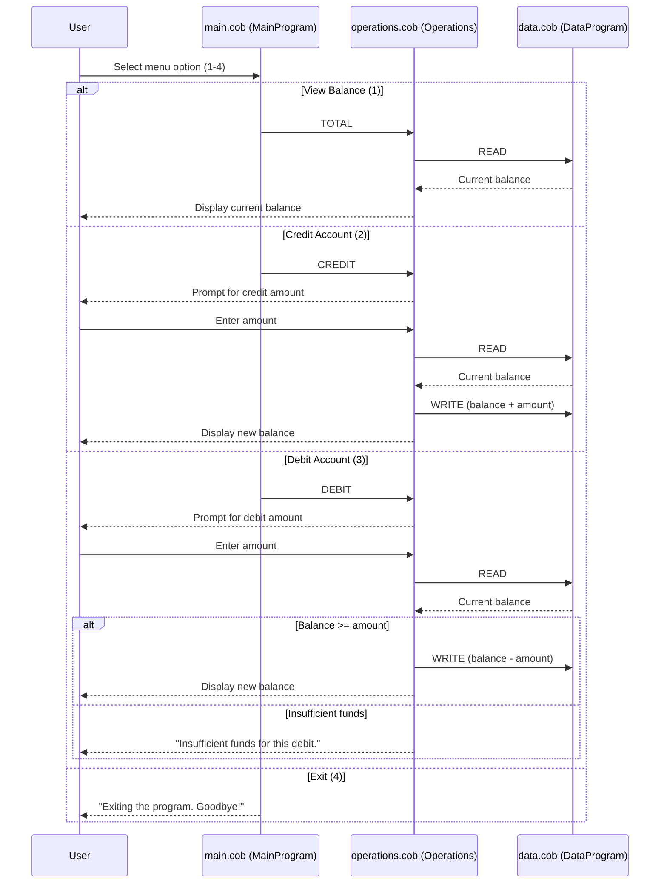

# Mergington High School — Legacy COBOL Accounting System

Documentation of the existing COBOL accounting application in `src/cobol/`,
prepared ahead of its modernization to Node.js. This system manages a single
student account balance used for student fees, cafeteria accounts, and school
supplies purchases.

## Files

### `main.cob` — MainProgram (user interface and menu)

`main.cob` is the entry point of the application. It runs a loop
(`PERFORM UNTIL CONTINUE-FLAG = 'NO'`) that displays the
"Account Management System" menu and accepts a numeric choice (1-4):

| Choice | Action | Call |
| ------ | ------ | ---- |
| 1 | View Balance | `CALL 'Operations' USING 'TOTAL '` |
| 2 | Credit Account | `CALL 'Operations' USING 'CREDIT'` |
| 3 | Debit Account | `CALL 'Operations' USING 'DEBIT '` |
| 4 | Exit | Sets `CONTINUE-FLAG` to `'NO'`, prints "Exiting the program. Goodbye!" and stops |

Any other choice prints "Invalid choice, please select 1-4." and shows the
menu again. `main.cob` contains no business logic itself; it only dispatches
to `operations.cob`.

### `operations.cob` — Operations (business logic)

`operations.cob` receives an operation type through its linkage section and
performs the account operations:

- **TOTAL** — reads the current balance by calling `DataProgram` with
  `'READ'`, then displays "Current balance: " followed by the balance.
- **CREDIT** — prompts "Enter credit amount: ", accepts an amount, reads the
  balance, adds the amount, writes the new balance back through
  `DataProgram` with `'WRITE'`, and displays "Amount credited. New balance: ".
- **DEBIT** — prompts "Enter debit amount: ", accepts an amount, reads the
  balance, and only subtracts and writes the new balance if the balance is
  greater than or equal to the amount, displaying "Amount debited. New
  balance: ". Otherwise it displays "Insufficient funds for this debit." and
  leaves the balance unchanged.

Amounts are `PIC 9(6)V99` (up to 999999.99, two decimal places).

### `data.cob` — DataProgram (balance storage)

`data.cob` is the data layer. It holds a single in-memory value,
`STORAGE-BALANCE PIC 9(6)V99 VALUE 1000.00`, so every run of the program
starts with a balance of **1000.00**. It accepts two operations through its
linkage section:

- **READ** — copies `STORAGE-BALANCE` into the caller's `BALANCE` field.
- **WRITE** — copies the caller's `BALANCE` field into `STORAGE-BALANCE`.

There is no file or database persistence: the balance lives only for the
duration of the program run, and there is a single shared account rather
than per-student accounts.

## Key business rules

1. The starting balance is always 1000.00.
2. A credit increases the balance by the entered amount.
3. A debit decreases the balance only when funds are sufficient
   (`FINAL-BALANCE >= AMOUNT`); otherwise it is rejected with
   "Insufficient funds for this debit." and the balance is unchanged.
4. Viewing the balance never modifies it.
5. Menu choices outside 1-4 are invalid and do not change any state.

## Data flow diagram

